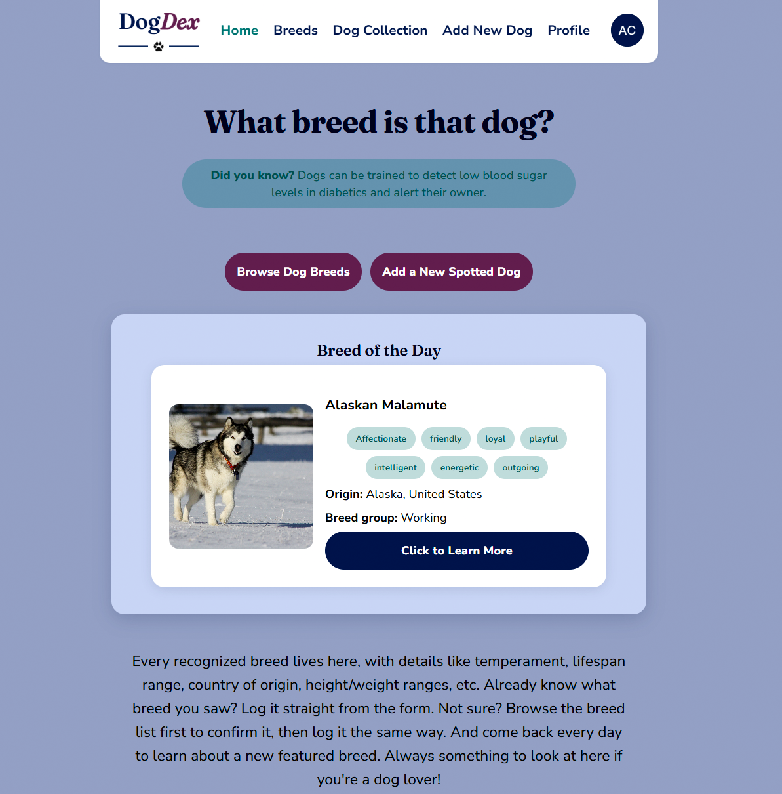
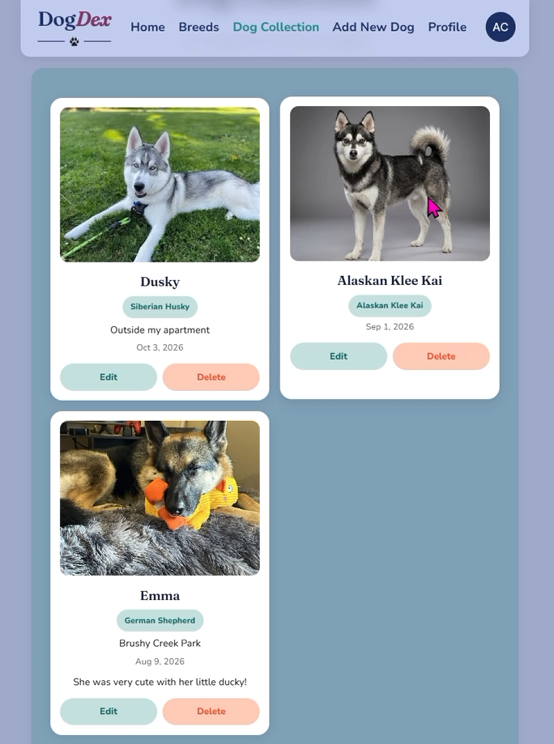

# DogDex

My capstone project for the March 2026 Austin Community College Software Development Bootcamp.

🔗 **Live site:** [dogdex.live](https://dogdex.live)

**DogDex** is a mobile-first web application for dog lovers who want to discover, track, and learn about dog breeds they encounter in real life.
Inspired by bird-watching and the beloved Pokédex concept, DogDex lets users browse a complete encyclopedia of recognized dog breeds, check off the ones they've spotted in the wild, and log each sighting with a photo, location, and personal notes. A Breed of the Day feature reveals a new breed on the home screen every morning, giving users a daily reason to open the app and learn something new.

### DogDex turns every walk, dog park visit, or trip to the neighborhood into an opportunity for discovery and connection with fellow dog lovers — making it equal parts hobby tracker, educational tool, and collection game.

## Demo
**Home Page after signing in**

**Spotted dogs are saved in your Dog Collection**

 
## Features
 
- A complete, searchable list of worldwide recognized dog breeds with names, photos, origin country, and key traits
- A "Breed of the Day" displayed on the home screen
- A breed detail page showing an "about" section with info like: lifespan, weight and height range in imperial, temperament, and origin information
- A personal dog collection log where users can attach a photo, location, date, and notes to each spotted dog
- A checkmark system allowing users to mark breeds as "spotted"
- Filter options on the breed list to toggle between All, Spotted, and Not Yet Spotted
- Secure user authentication, including Google sign-in

## Tech Stack
 
**Frontend:** React, Vite, React Router, Clerk (auth)
 
**Backend:** Node.js, Express, Mongoose
 
**Database:** MongoDB Atlas
 
**Other services:** Clerk (authentication), Cloudinary (image uploads), TheDogAPI (breed data source)
 
## Deployment
 
| Piece         | Hosted on                                                                                 |
| ------------- | ----------------------------------------------------------------------------------------- |
| Frontend      | [Netlify](https://www.netlify.com/)                                                       |
| Backend / API | [Render](https://render.com/)                                                             |
| Database      | [MongoDB Atlas](https://www.mongodb.com/atlas)                                            |
| Auth          | [Clerk](https://clerk.com/) (production instance)                                         |
| Domain        | Custom domain via Namecheap, routed to Netlify (frontend) and a subdomain to Render (API) |
 
 
## Future features may include:
 
- Gamification with a social media element
- Ability to take photos in-app
- AI-powered dog breed identification
- Partnerships with local animal shelters advocating for dogs to get adopted
- A fully developed native mobile app version

## Author
 
**Audrey Clark**
[Portfolio](https://audreyclark.dev) · [GitHub](https://github.com/audreyclarkdev) · [LinkedIn](https://linkedin.com/in/audrey-clark-dev)
 
